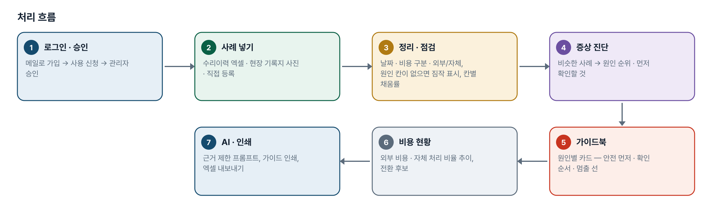
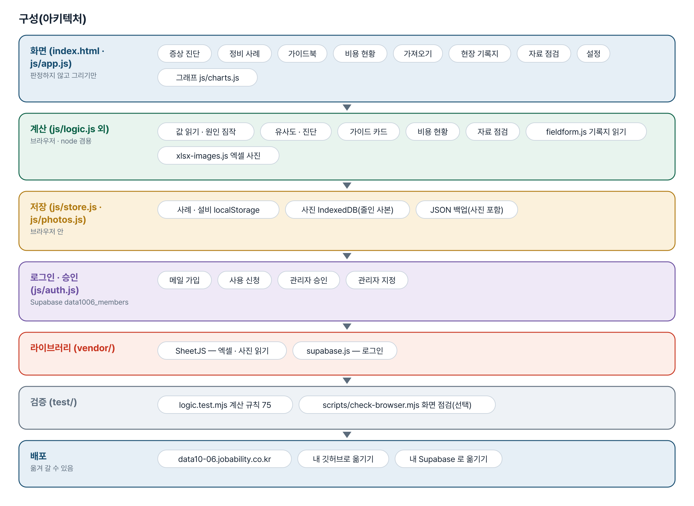
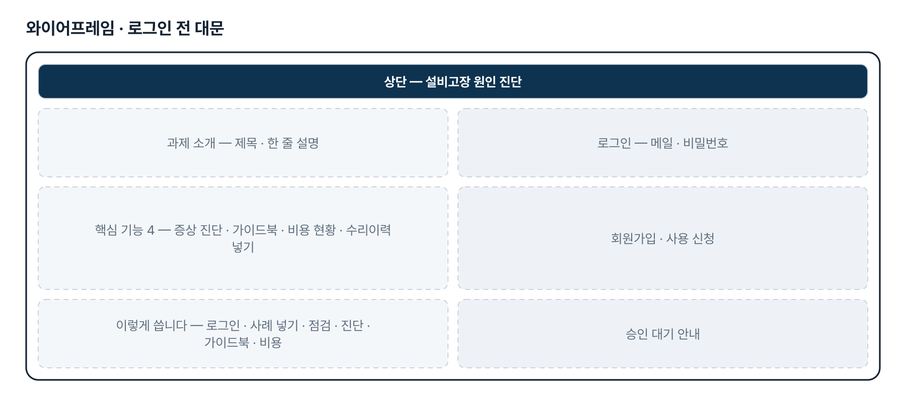
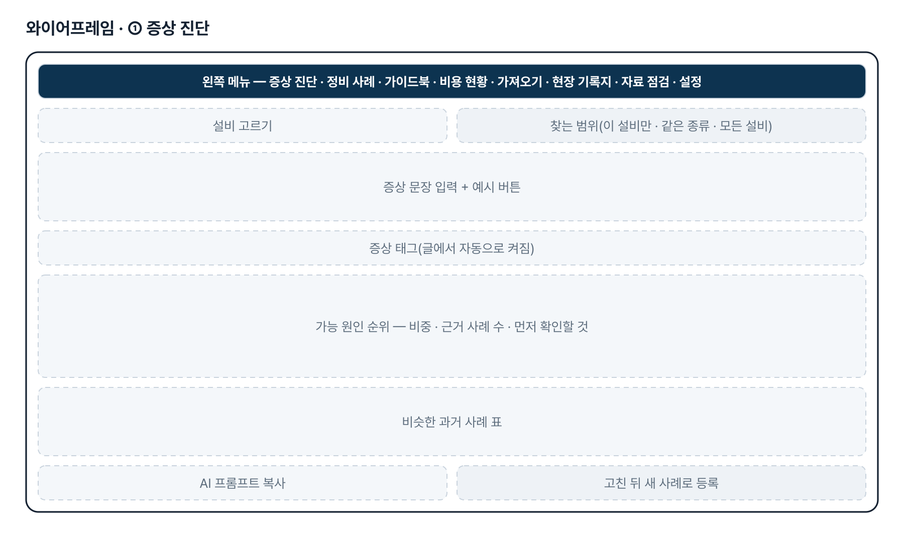
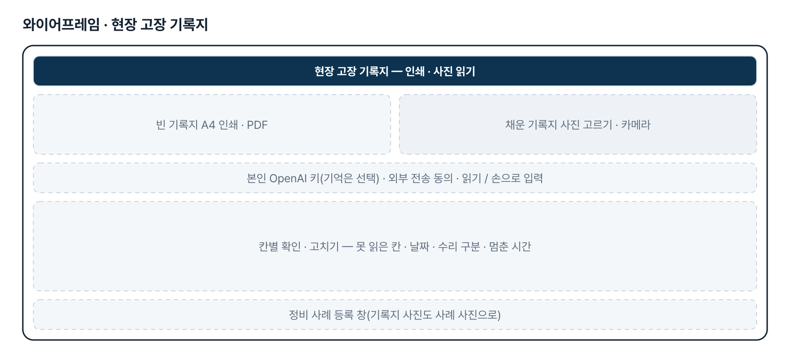
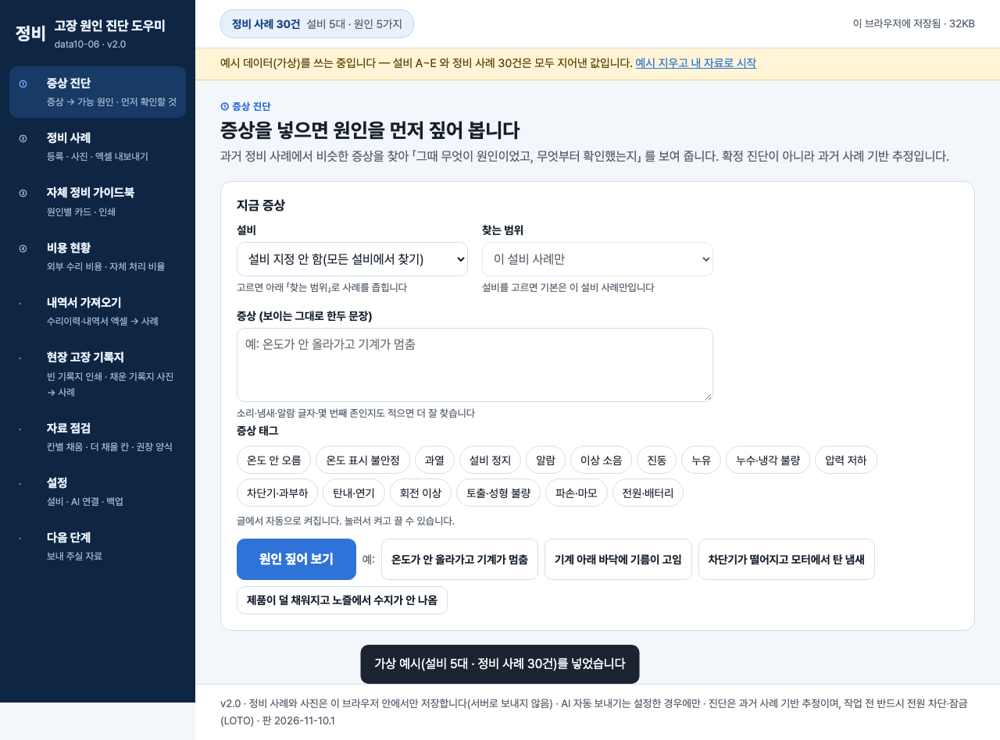

# 설비고장 원인 진단 — 프로젝트 기획서 v2.0

- 기획: 유상진 · 작성일 2026-11-10 · 현장 데이터 디지털화 전문가과정 · 2차수 프로젝트 06
- 바로 쓰기: https://data10-06.jobability.co.kr/
- 워드 판: `docs/기획서/data10-06_유상진_설비고장원인진단_기획서_v2.0.docx`

## 개요

증상을 넣으면 과거 정비 사례에서 가능한 고장 원인과 「먼저 확인할 것」을 짚어 주고, 쌓인 사례로 초보자용 자체 정비 가이드북과 외부 수리 비용 현황을 만드는 도구입니다.

### 배경 · 현재 업무
- 숙련자가 퇴사한 뒤 남은 인력은 근속년수가 짧아 설비 고장 때 대처가 어렵습니다.
- 고장 원인 자체를 몰라 매번 외부 수리 인력을 부르고, 수리 비용이 계속 늘고 있습니다.
- 외부 업체 정비 내역서 · 수리이력 엑셀과 고장 때 찍어 둔 사진은 있지만 「증상 → 원인」 사례집으로 묶여 있지 않습니다.
- 수리이력 엑셀에는 원인 칸이 따로 없고 증상 · 조치 글에 섞여 있습니다.

### 목표
- 증상 문장 하나로 과거 사례 기반 원인 순위와 먼저 확인할 것을 보여 줍니다.
- 외부 수리 기사가 고친 내역을 쌓아 초보자가 따라 할 수 있는 원인별 정비 가이드북을 만듭니다.
- 외부 수리 비용과 자체 처리 비율의 변화를 봅니다.
- 지금 쓰는 수리이력 엑셀(사진 포함)과 현장 종이 기록지를 그대로 사례로 넣습니다.

## 요구사항과 구현

| 기획서 요구 | 구현 |
|---|---|
| 고장 원인 진단 챗봇 — 증상을 넣으면 원인을 먼저 짚어 줌 | 한국어 글자 2개 묶음 유사도 + 증상 태그 + 같은 설비로 비슷한 사례를 찾아 원인 순위 · 근거 사례 수 · 먼저 확인할 것, AI 프롬프트(복사 · 선택 자동 보내기) |
| 「우선 센서 연결부터 확인」처럼 첫 확인을 안내 | 사례의 안전 단계를 뺀 첫 조치 단계를 「먼저 확인할 것」으로, 예시가 그대로 나오는지 테스트로 묶음 |
| 초보자용 자체 정비 가이드북 | 원인별 카드 자동 초안 — 안전 먼저 · 확인 순서 · 「초보자는 여기까지」 선 · 공구 · 부품 · 전문가를 부를 때, 고치기 · 인쇄 |
| 정비 내역서 · 영수증 활용 | 수리이력 엑셀 그대로 가져오기(여러 시트 · 병합 셀 · 열 맞추기 · 원인 짐작 · 비용 미기재/무상/견적 구분) |
| 고장 사진 · 동영상 활용 | 사례별 사진(줄인 사본), 엑셀 칸 위에 붙인 사진을 그 줄의 사례로. 동영상은 위치만 |
| 외부 수리 비용 줄이기 | 외부 비용 · 건수 · 자체 처리 비율, 월별 · 설비별 · 원인별, 자체 처리 전환 후보 |
| 현장 기록지(4차 양식) | 빈 기록지 A4 인쇄, 채운 기록지 사진 → 본인 OpenAI 키로 읽기 → 칸별 확인 → 사례 등록 |
| 매뉴얼 근거 질의 · 팀 공유 | 2단계 — 지금은 매뉴얼 메모 발췌를 프롬프트에 넣고, 자료는 브라우저별 저장 + JSON 백업 |

## 주요 기능

- **증상 진단** — 증상 문장과 태그로 비슷한 과거 사례를 찾아 원인 순위 · 비중 · 근거 사례 수 · 먼저 확인할 것을 보여 줍니다.
- **자체 정비 가이드북** — 사례에서 원인별 카드를 자동으로 만들고 안전 먼저 · 확인 순서 · 초보자가 멈출 선을 표시합니다.
- **비용 현황** — 외부 수리 비용 · 건수 · 자체 처리 비율을 월별 · 설비별 · 원인별로 보고 앞 기간과 비교합니다.
- **수리이력 · 기록지 넣기** — 수리이력 엑셀(붙인 사진 포함)을 그대로 읽고, 종이 기록지 사진을 칸별로 읽어 사례로 넣습니다.
- **정비 사례** — 설비 · 증상 · 원인 · 조치 단계 · 부품 · 외부/자체 · 비용 · 사진을 한 건씩 쌓고 거르고 엑셀로 냅니다.
- **자료 점검** — 칸별 채움률과 기능별 상태, 중복 의심 줄을 보여 주고 권장 양식으로 내보냅니다.
- **AI 프롬프트** — 증상 · 비슷한 사례 · 매뉴얼 발췌만 근거로 답하게 하는 프롬프트를 복사하거나 설정한 AI 서버로 보냅니다.
- **백업** — 사진까지 담은 JSON 으로 받아 두고 되살립니다.
- **로그인 · 사용 승인** — 회사 메일이나 개인 메일로 가입해 사용 신청, 관리자가 승인하면 씁니다.

## 처리 흐름(파이프라인)

1. **로그인 · 승인** — 메일로 가입 → 사용 신청 → 관리자 승인
2. **사례 넣기** — 수리이력 엑셀 · 현장 기록지 사진 · 직접 등록
3. **정리 · 점검** — 날짜 · 비용 구분 · 외부/자체, 원인 칸이 없으면 짐작 표시, 칸별 채움률
4. **증상 진단** — 비슷한 사례 → 원인 순위 · 먼저 확인할 것
5. **가이드북** — 원인별 카드 — 안전 먼저 · 확인 순서 · 멈출 선
6. **비용 현황** — 외부 비용 · 자체 처리 비율 추이, 전환 후보
7. **AI · 인쇄** — 근거 제한 프롬프트, 가이드 인쇄, 엑셀 내보내기

## 구성(아키텍처)

- **화면 (index.html · js/app.js)** — 증상 진단 · 정비 사례 · 가이드북 · 비용 현황 · 가져오기 · 현장 기록지 · 자료 점검 · 설정 · 그래프 js/charts.js
- **계산 (js/logic.js 외)** — 값 읽기 · 원인 짐작 · 유사도 · 진단 · 가이드 카드 · 비용 현황 · 자료 점검 · fieldform.js 기록지 읽기 · xlsx-images.js 엑셀 사진
- **저장 (js/store.js · js/photos.js)** — 사례 · 설비 localStorage · 사진 IndexedDB(줄인 사본) · JSON 백업(사진 포함)
- **로그인 · 승인 (js/auth.js)** — 메일 가입 · 사용 신청 · 관리자 승인 · 관리자 지정
- **라이브러리 (vendor/)** — SheetJS — 엑셀 · 사진 읽기 · supabase.js — 로그인
- **검증 (test/)** — logic.test.mjs 계산 규칙 75 · scripts/check-browser.mjs 화면 점검(선택)
- **배포** — data10-06.jobability.co.kr · 내 깃허브로 옮기기 · 내 Supabase 로 옮기기

## 화면 구성(와이어프레임)

## 규칙 · 판정 기준

- 원인 비중은 비슷한 사례의 유사도를 원인별로 더한 비율입니다. 근거 사례 수와 많음 · 보통 · 적음을 함께 보여 주고, 비슷한 사례가 없으면 지어내지 않습니다.
- 「먼저 확인할 것」은 안전 단계(전원 차단 · 잠금)를 뺀 첫 조치 단계입니다. 안전은 늘 따로 보여 줍니다.
- 측정 · 배선 · 분해 · 주요 부품 교체 같은 단계는 담당자 · 전문가 단계로 보고, 그 앞에 「초보자는 여기까지」 선을 긋습니다.
- 원인 칸이 없는 줄은 증상 · 조치에서 짐작하고 끝까지 「짐작」으로 표시합니다. 「원인미확인」은 미상으로 봅니다.
- 비용 미기재는 0원이 아닙니다. 무상 · 0원과 견적은 실지출과 따로 셉니다.
- 기록지 사진 읽기 결과는 사람이 확인하고 등록 창에서 저장해야 사례가 됩니다. 증상이 없으면 등록하지 않습니다.

## 검증

- 계산 규칙 테스트 75개 통과
- node test/logic.test.mjs 75개 통과(2026-11-10). 현장 기록지 읽기는 가짜 fetch 로 시험합니다.
- 4차 때 옛 코드로 되돌려 날짜 · 부품 나누기 · 원인미확인 시험 3개가 실패하는 것, 새 코드를 10가지로 일부러 깨뜨려 각각 실패하는 것을 확인했습니다.
- 실제 OpenAI 키로는 부르지 않았습니다 — 실제 사진 읽기 품질은 본인 키로 한 장 시험해 판정합니다.
- 화면 점검 scripts/check-browser.mjs(선택) — 9화면 × 2폭 넘침 0 · JS 오류 0.

## 이번 판에서 하지 않는 것

- 업무 자료(사례 · 사진)는 아직 팀 공유 DB 가 아니라 이 브라우저에 저장됩니다. 팀원과 나누려면 JSON 백업을 주고받습니다.
- 진단은 과거 사례 기반 추정이며 확정 진단이 아닙니다.
- 설비 매뉴얼 PDF 근거 질의(RAG)와 대화형 챗봇은 하지 않습니다.
- 동영상은 저장하지 않고 위치만 적습니다. 종이 · PDF 내역서 자동 읽기는 기록지 사진 읽기만 있습니다.

## 다음 단계

- 팀 공유 저장 — 여러 사람이 같은 사례집을 함께 쓰기
- 설비 매뉴얼 근거 질의(RAG)
- 실제 기록지 사진으로 읽기 품질 확인, 필요하면 여러 장 한꺼번에 읽기
- 업체가 말한 원인을 원인 칸에 받아 짐작을 줄이기

## 버전 이력

- **v2.0** (2026-11-10) — 최종 기획서 — 파이프라인 · 아키텍처 · 와이어프레임 정리 / 로그인 · 사용 신청 · 관리자 승인(요청자 Supabase 로 옮길 수 있게) / 로그인 전 대문
- **v1.4** (2026-11-08) — 4차 — 권장 양식 정리본 점검(엑셀 날짜 하루 앞 · 부품 「/」 · 원인미확인 · 부품 없음) / 현장 고장 기록지 — 인쇄 · 사진 → 본인 OpenAI 키로 읽기 → 확인 → 사례
- **v1.3** (2026-10-27) — 3차 — 수리이력 수정본 양식, 엑셀에 붙인 사진을 사례에 붙이기 / 진단 「찾는 범위」(이 설비만 · 같은 종류 · 모든 설비)
- **v1.2** (2026-10-21) — 2차 — 실제 수리이력 양식 그대로 읽기, 원인 짐작, 비용 구분, 자료 점검 화면
- **v1.1** (2026-10-20) — 1단계 — 증상 진단 · 정비 사례 · 자체 정비 가이드북 · 비용 현황
